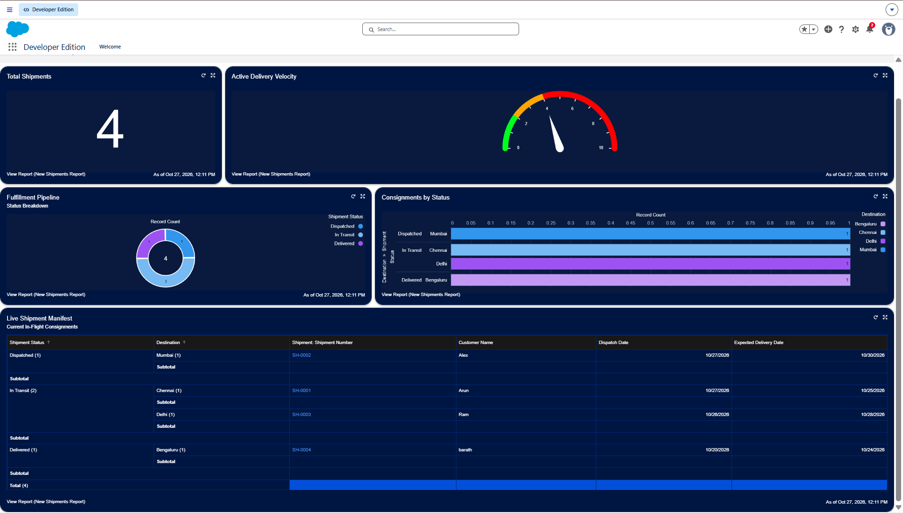

# Swift Ship Tracker

An enterprise Salesforce CRM application designed to track shipments, monitor delivery deadlines, and automatically flag overdue consignments.

---

## Operations Dashboard

---

## Project Purpose
In logistics operations, tracking shipments using spreadsheets or paper manifests leads to delayed updates, missed delivery targets, and poor visibility. 

Swift Ship Tracker solves this by providing a centralized system inside Salesforce where dispatch teams can log consignments, monitor delivery dates in real time, and automatically identify delayed shipments without manual checking.

---

## What the System Does

1. **Shipment Tracking**
   Every shipment is assigned a unique auto-generated tracking number (`SH-0001`, `SH-0002`, etc.) along with the customer's name, target destination, dispatch date, expected delivery date, and current status.

2. **Status Progression**
   Shipments move through five distinct stages:
   * **Pending:** Order received, preparing for dispatch.
   * **Dispatched:** Consignment has left the facility.
   * **In Transit:** Shipment is on the way to the destination city.
   * **Delivered:** Successfully received by the customer.
   * **Delayed:** Missed the expected delivery deadline.

3. **Automated Overdue Detection**
   A scheduled background Flow (`Mark_Overdue_Shipments`) runs automatically every day. It compares the **Expected Delivery Date** against the current date. If a shipment's deadline has passed and it has not been marked as "Delivered", the system automatically changes its status to **Delayed**.

4. **Executive Operations Dashboard**
   * **Total Shipments:** Shows total package volume in the system.
   * **Active Delivery Velocity:** A visual gauge measuring fulfillment speed.
   * **Fulfillment Pipeline:** A donut chart showing the breakdown between dispatched, in transit, and delivered packages.
   * **Consignments by Status & Destination:** A bar chart comparing shipment loads across destinations (Chennai, Mumbai, Delhi, Bengaluru).
   * **Live Shipment Manifest:** A detailed table listing all active shipments, customers, dispatch dates, and target arrival dates.

---

## Custom Object: Shipment (`Shipment__c`)

| Field Label | API Name | Data Type | Purpose |
| :--- | :--- | :--- | :--- |
| Shipment Number | `Name` | Auto Number (`SH-{0000}`) | System-generated tracking ID |
| Customer Name | `Customer_Name__c` | Text(100) | Name of the customer receiving the delivery |
| Destination | `Destination__c` | Text(100) | Delivery destination city |
| Dispatch Date | `Dispatch_Date__c` | Date | The date the shipment departed |
| Expected Delivery Date | `Expected_Delivery_Date__c` | Date | Target delivery deadline |
| Shipment Status | `Shipment_Status__c` | Picklist | Current status of the shipment |
